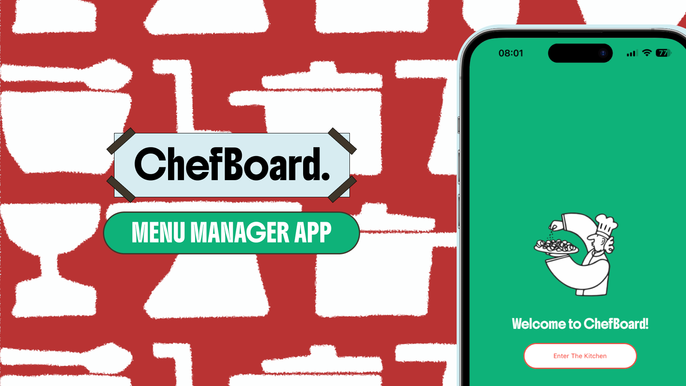
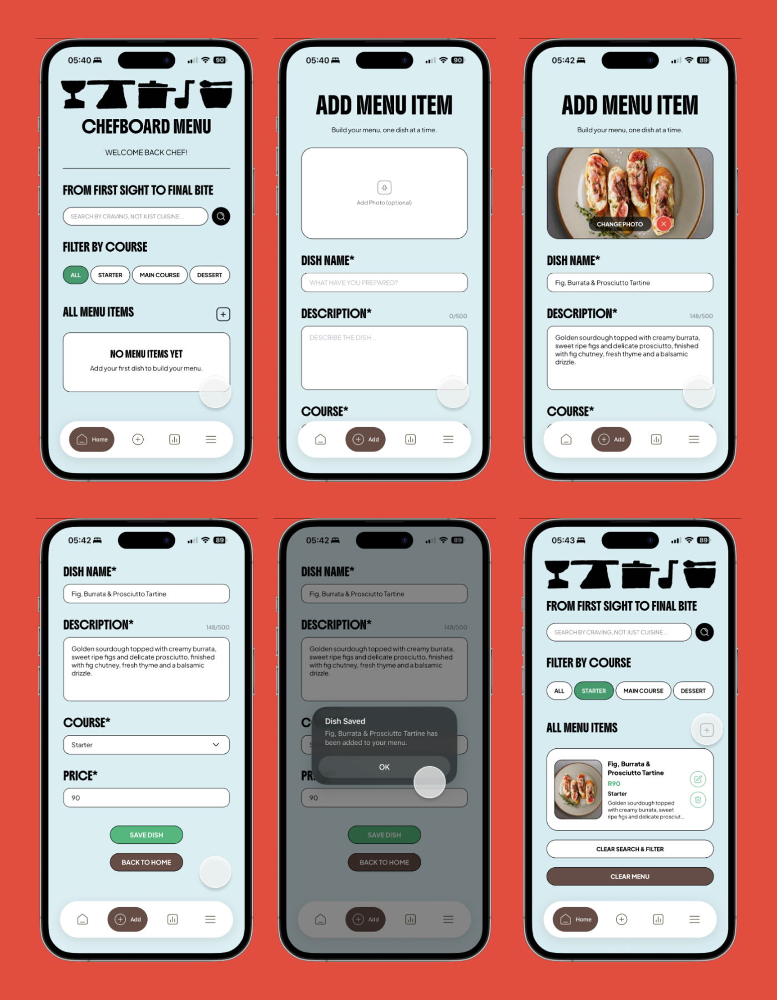
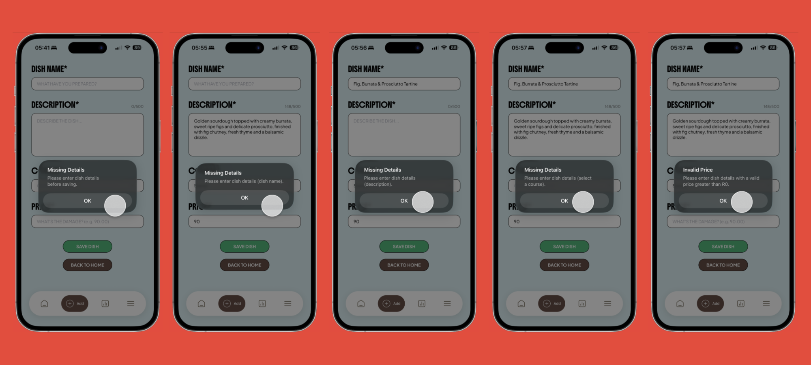
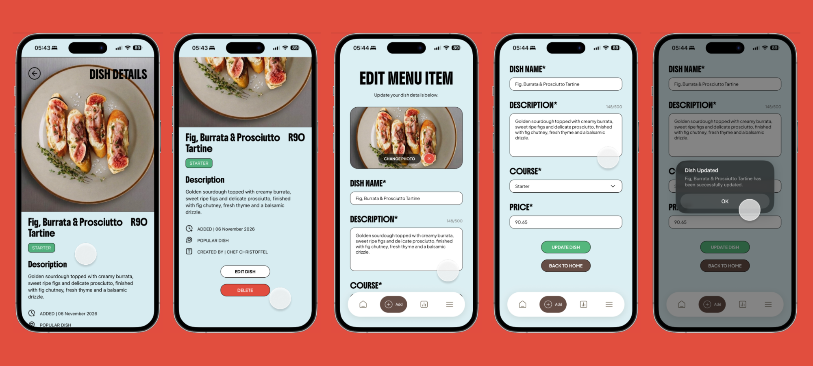
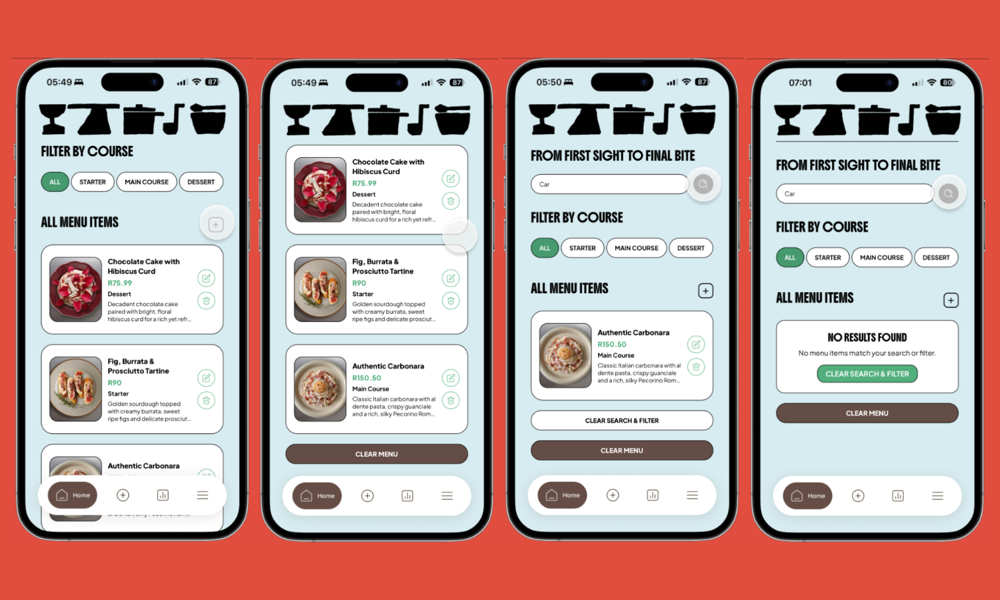
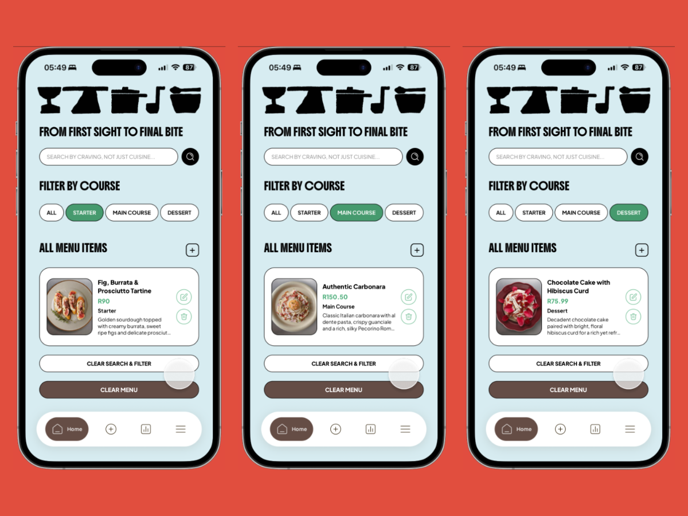
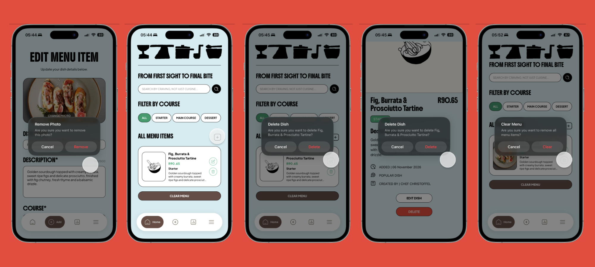
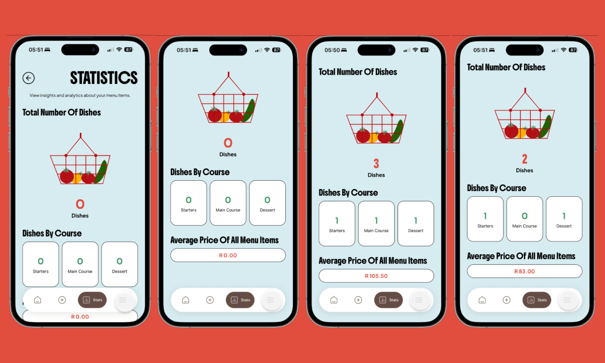
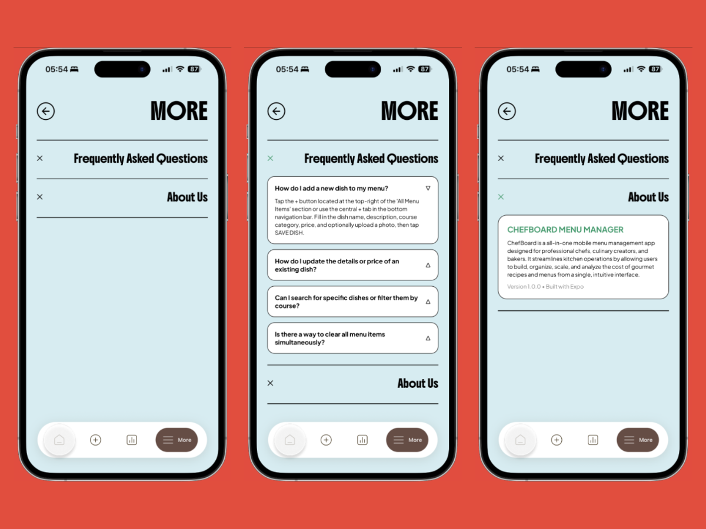

# ChefBoard App

**ChefBoard** is an all-in-one mobile menu management application designed for professional chefs, culinary creators, and artisanal bakers. It streamlines kitchen operations by allowing users to build, organize, update, scale, and analyze the statistics of gourmet recipes and menus from a single, intuitive interface.

## App Walkthrough Video

[ ✦ See What's Cooking ✦ ](https://youtu.be/7U5GP29fuKY)

**Note: Remember to change the viewing quality to 1080p**

## Main Screens

### Home
The home screen provides a centralized overview of the chef's menu, including:

- Search bar for quick lookup and course-based filter tabs (All, Starter, Main Course, Dessert)
- Grid/card layouts for all active menu items with quick edit and delete actions
- Navigation access to Add, Stats, and More views

### Add & Edit Menu Item
The dish form allows the chef to enter or modify:

- Dish name
- Description
- Course category
- Price
- Optional dish photo (with add/change and photo removal functionality)

### Dish Details
The dish-details screen displays:

- Dish photo or default illustration
- Dish name, price, course, and description
- Date added and action triggers to edit or delete the dish

### Menu Statistics (`stats.tsx`)
Provides real-time analytics and insights:

- Total number of dishes accompanied by a custom basket graphic
- Course-specific tallies for Starters, Main Courses, and Desserts
- Average price calculation across all active menu items

### More & FAQ (`more.tsx`)
Features an expandable accordion menu containing:

- Frequently Asked Questions regarding menu management, adding/editing dishes, and search functions
- About Us overview detailing the app's purpose and build specifications

## Features

- **Clean Aesthetic** → A high-contrast minimalist interface featuring rounded white cards and custom typography.
- **Add Menu Items** → Add a dish name, description, course category, price, and optional dish photo.
- **Dish Photos** → Add, change using Expo Image Picker.

- **Menu Validation** → Built-in validation prompts if required fields are left empty.

- **Dish Details** → Open an individual dish to view its complete culinary breakdown and metadata.
- **Edit Operations** → Update existing dish details/prices.

- **View Menu & Search** → View all saved dishes on the home screen and search for specific recipes instantly by name.

- **Filter Validation & Course Filtering** → Filter items instantly by course (Starter, Main Course, Dessert) or reset filters, with validation prompts to guide your search and category selection.

- **Remove Dish Photos** → Remove photos using Expo Image Picker.
- **Delete Operations** → Delete single items seamlessly.
- **Clear Menu** → Remove all currently stored menu items with a single confirmation prompt.

- **Menu Statistics & Analytics** → Track total dish counts, individual course breakdowns, and average menu item pricing in real-time.

- **More & FAQ Accordion** → Access interactive FAQs and About Us information via expandable drop-down menus.

## Getting Started

Follow these steps to set up and run **ChefBoard** locally on your machine.

### Prerequisites
- Node.js installed on your system
- npm, yarn, or pnpm
- Expo Go app installed on your mobile device (iOS/Android) or a running emulator/simulator.

### Installation

1. **Clone the repository:**

- git clone [https://github.com/Lethabomohlala/ChefBoard.git](https://github.com/Lethabomohlala/ChefBoard.git)
- cd `ChefBoard`

2. **Install dependencies:**

- `npm install` or `yarn install`

3. **Start the development server:**

- `npx expo start`

4. **Run the app:**

- Scan the QR code using the Expo Go app (Android) or Camera app (iOS).
- Press a for Android emulator or i for iOS simulator.

## Technical Stack

- React Native
- Expo & Expo Router
- TypeScript
- React Native Safe Area Context
- React Native SVG
- Expo Image Picker
- VSCode

## Menu Data Management

Items are managed globally using `MenuContext.tsx`. Each menu item contains:

- `id`
- `name`
- `description`
- `course`
- `price`
- `dateAdded`
- `image`

## Design Considerations

ChefBoard was designed with simplicity, usability, and visual clarity in mind:

- **Simple Navigation |** Straightforward navigation and tab routing.
- **User-Friendly Interface |** Clearly labeled forms and interactive elements.
- **Visual Consistency |** Cohesive color palette (`#D7ECF1` background, `#469A6E` green, `#E14E3E` red), rounded white cards (24px), and custom typography.
- **Responsive Layout |** Adapts cleanly across mobile screen viewports.
- **Visual Feedback |** Confirmation alerts and state updates for all CRUD actions.

## PROJECT CHANGELOG | Changes since Part 2: 10 September 2026

### v1.0.0 | 06 November 2026

### Added 

#### Navigation & Routing |

- Integrated back-navigation routing to home and structured culinary content styling.

#### Menu & Dish Management |

- Added updateMenuItem function to edit existing dishes in state.
- Added deleteMenuItem function to remove dishes from state.
- Added remove photo capability to dish form, including a removePhoto handler with a confirmation alert and an action button (x) alongside the change photo overlay.
- Added decimal handling and normalization for price input.
- Added course filter chips (All, Starter, Main Course, Dessert) with instant filtering.
- Added inline SVG action buttons for dish editing and deletion.

#### UI Components & Features |

- Added state-managed dropdown expansion for Frequently Asked Questions and About Us sections in more.tsx.
- Implemented interactive accordion menu and layout alignment into more.tsx.
- Implemented live menu statistics and analytics overview, connecting stats.tsx to MenuContext for real-time item tracking and dynamic course/price calculations.
- Implemented spelling tolerance for search.
- Implemented empty and no-results feedback UI with filter reset functionality.
- Added search TextInput capped at 50 characters with auto-capitalization.
- Addition to image assets.

### Updated 

#### UI, Layout & Styling |

- Refactored UI layout and search/filtering workflows.
- Removed course count cards from top section of home screen.
- Updated MenuContextType interface and Provider value.
- Updated TabBar onPress handler to safely evaluate optional navigation.emit before pushing routes.
- Aligned Expo SDK 58 dependencies and cleared bundler/TypeScript cache issues.
- Repositioned divider lines to render cleanly at the bottom of each accordion section.
- Aligned accordion titles to the right with expansion icons (x) positioned on the left.
- Implemented dynamic color-shifting on active accordion icons.
- Updated stats.tsx UI.
- Updated dishdetails.tsx default image background colour.
- Updated more.tsx about description.
- Connected edit and delete actions to global menu context, importing deleteMenuItem with confirmation alert and redirection, and updating handleEdit to navigate to add.tsx carrying current dish id for seamless form pre-filling.
- Redesigned menu item cards to a white background with rounded borders and stacked layout.
- Positioned dish price directly below dish name on the left side, and placed edit/delete action buttons vertically on the right.
- Increased font sizes and padding for dish titles and course labels to prevent text overflow.
- Moved utensils.png outside of the padded scroll view container to prevent clipping and disappearing bugs caused by negative margins.
- Cleared form state and reset inputs on new dish creation.
- Implemented pre-filled editing, form validations, navigation, and UX controls.

#### Documentation |

- Updated README.md to reflect current project setup, feature additions, and system workflows.

### Fixed 

#### Component & Routing Fixes |

- Fixed incorrect relative import path for Expo router in TabBar component.

## Future Improvements

ChefBoard will undergo ongoing development past its current release, with future updates focused on long-term enhancements.

### Long-term
- **Menu Export |** Allow chefs to export menus as PDFs or shareable backups.
- **Cloud Synchronization | ** Synchronize menu data across multiple kitchen devices.
- **User Accounts |** Support individual chef profiles and personalized portfolios.
- **Advanced Analytics |** Provide deeper insights into ingredient costs and menu profitability.
- **App Store Preparation |** Finalize promotional assets, privacy policies, and store listings.

## Author

**Lethabo Mohlala**

### Copyright

© 2026 Lethabo Mohlala. All rights reserved.

This project and its source code are intended for educational and project purposes. Unauthorized copying, redistribution, or commercial use of this project is not permitted without permission from the Author.